# The News

A poster-wall news reader for iPhone and iPad, built on [NewsAPI.org](https://newsapi.org) with SwiftUI and the VIPER architecture.

Every news category is a full-screen Swiss-style poster. Tap through to its sources, then to the latest articles, and read any story in the built-in web reader. Search finds both sources and articles, and every list keeps loading as you scroll.

<p align="center">
  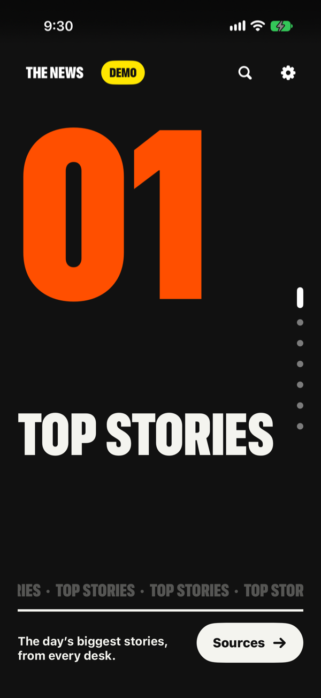
  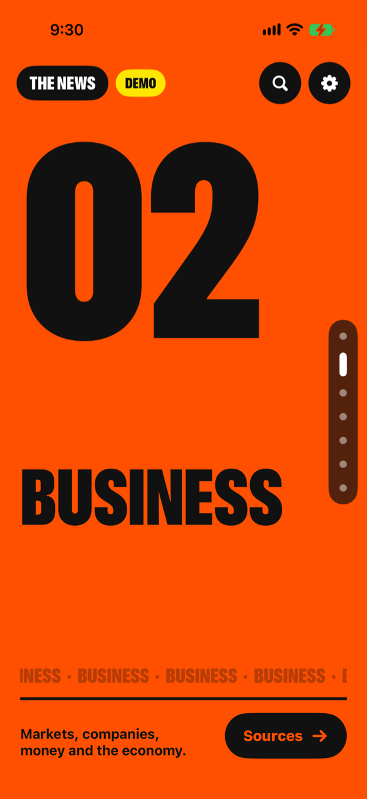
  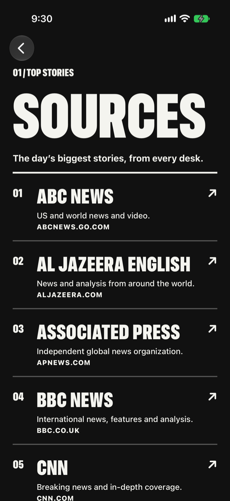
  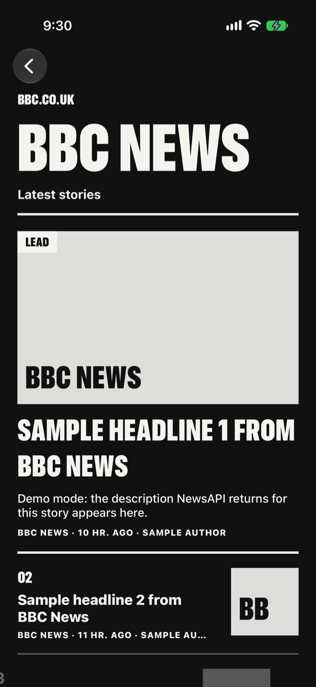
</p>

## Features

| User story | How the app handles it |
| --- | --- |
| Browse news categories | Seven categories, each a full-screen poster with its own colour, a giant section number with parallax, and a scrolling title strip. Page vertically on iPhone; on iPad they hang on a tilting poster wall. |
| See sources for a category | Numbered list of every NewsAPI source in that category, with description and domain. |
| See articles from a source | A lead story set big, then numbered articles with duotone photos tinted to the category colour. |
| Read an article | Native SwiftUI `WebView` with a progress bar, a designed loading card, back, reload, share and Open in Safari. |
| Search sources and articles | One giant search field with Sources and Articles tabs, live result counts and a debounced query. |
| Endless scrolling | Sources and articles load the next page as you near the end, with a footer for loading, end of list and inline retry. |
| Positive and negative cases | Every screen has a designed loading skeleton, an empty state and an error state with retry, plus a toast when a refresh fails while content is visible. |

Also included:

- **iPhone landscape:** each screen has its own landscape layout, not a stretched portrait one (split posters, a pinned title panel next to the list, a side rail in the reader).
- **iPad:** a carousel poster wall, multi-column grids, larger type, and support for split view and Stage Manager window sizes.
- **Demo mode:** explore the whole app offline with clearly labelled sample data, no key needed.
- **Accessibility:** VoiceOver labels on controls, and Reduce Motion support that pauses the moving title strips.
- **Haptics and motion:** spring animations, haptic taps and press feedback throughout.

## Screenshots

### Reading flow

<p align="center">
  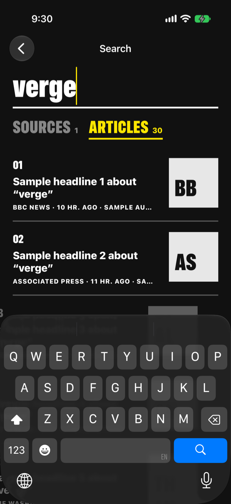
  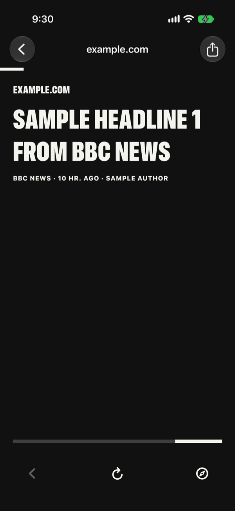
  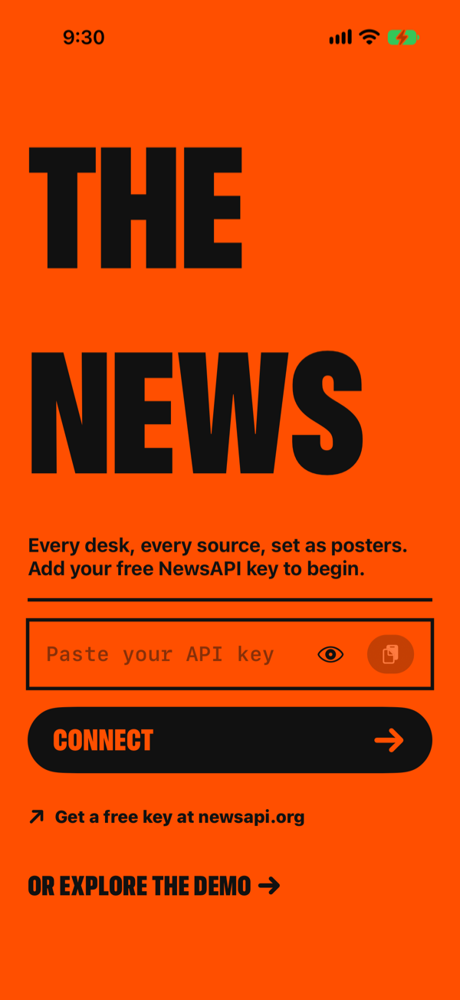
</p>

### Empty and error states

<p align="center">
  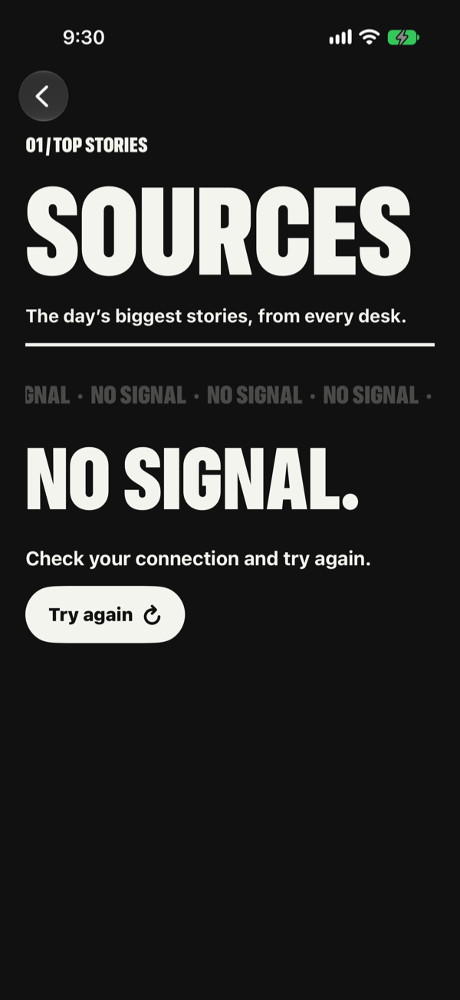
  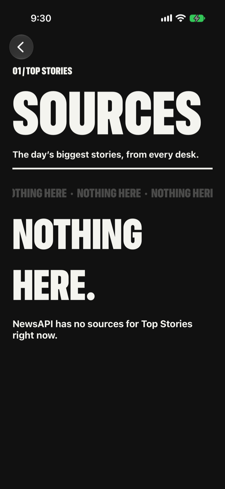
  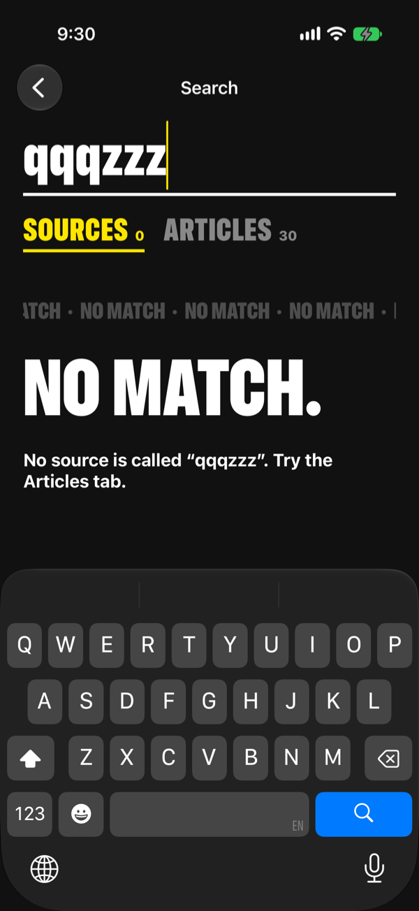
</p>

### iPhone landscape

<p align="center">
  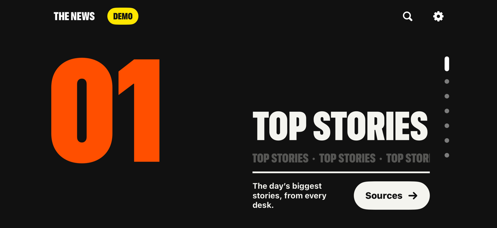
  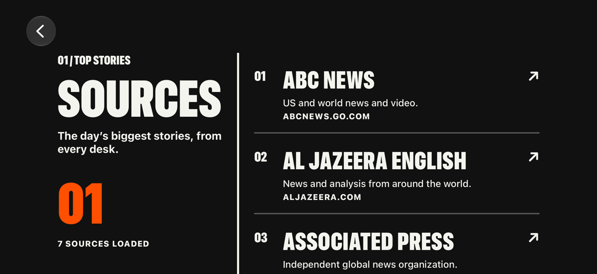
  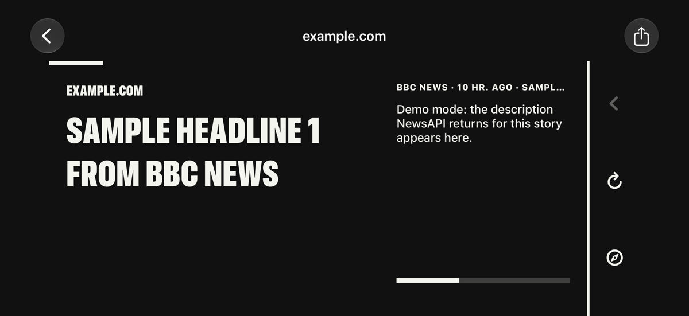
</p>

### iPad

<p align="center">
  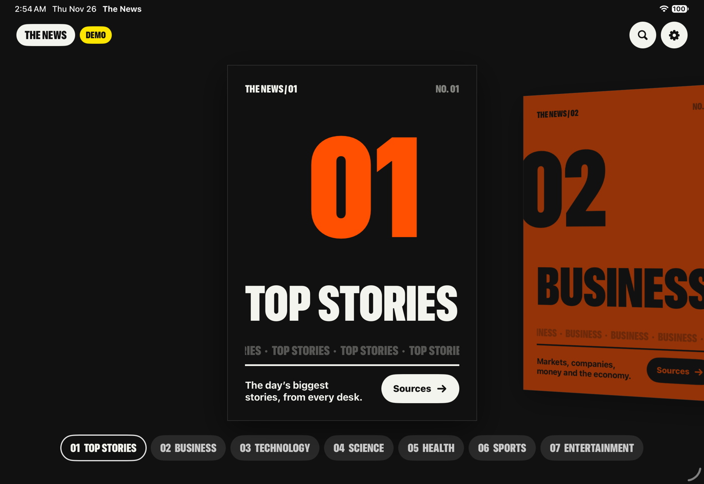
  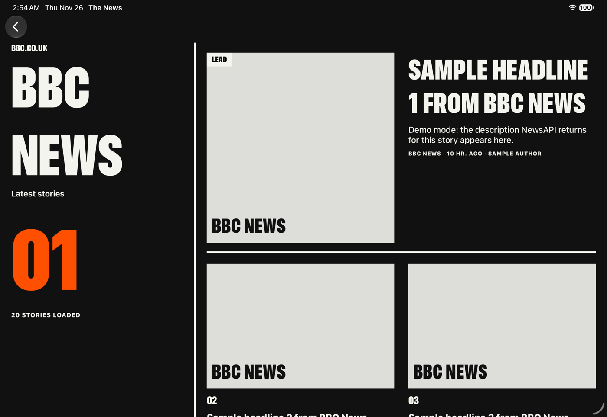
</p>
<p align="center">
  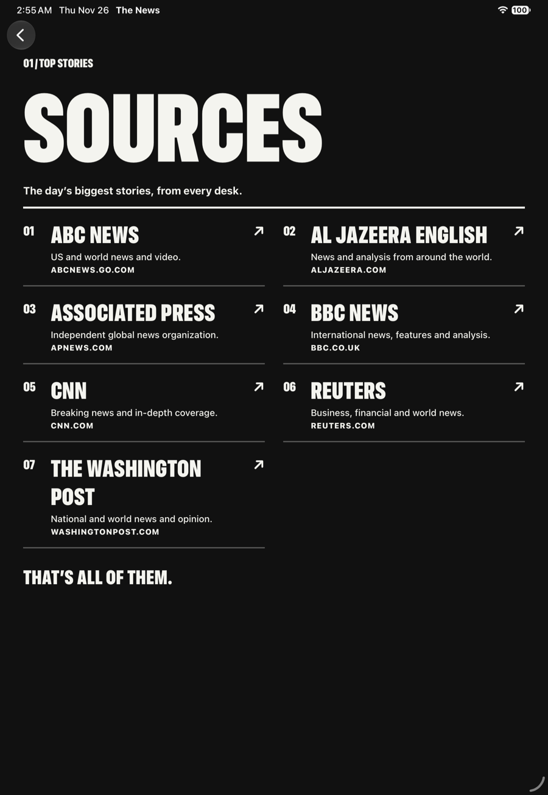
  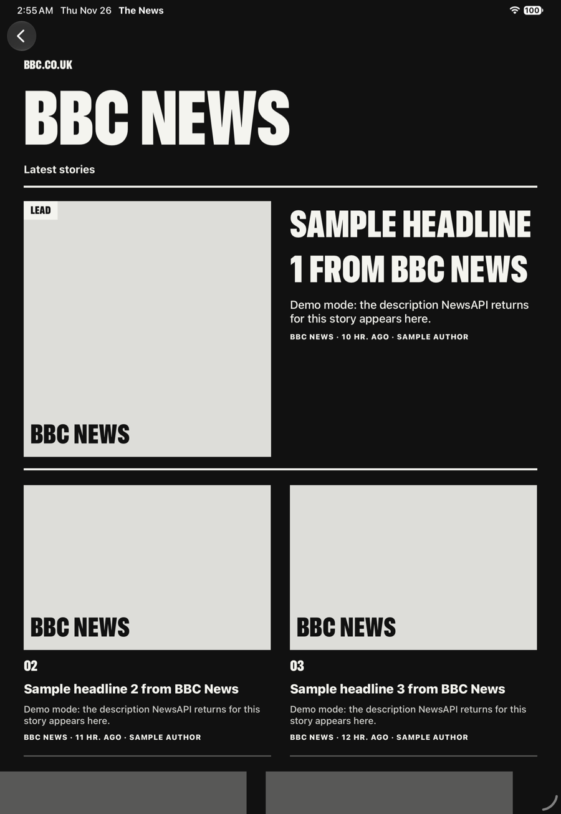
</p>

> Screenshots use demo mode, so article photos show as typographic placeholders. With a real key they appear as duotone images.

## Architecture

The app uses **VIPER**. Each screen is a module with the same parts:

```
View  ──▶  Presenter  ──▶  Interactor  ──▶  NewsRepository  ──▶  NewsAPIClient
  ▲            │                                                (or StubNewsRepository)
  └── state ───┤
               └──▶  Router  ──▶  Navigator (NavigationStack path)
```

| Part | Responsibility |
| --- | --- |
| **View** | SwiftUI only. Renders presenter state and forwards user actions. |
| **Presenter** | `@Observable`, main-actor. Owns screen state (`Paginator`, `LoadState`), debouncing and retry logic. |
| **Interactor** | Talks to the repository. For example, sources are cached and paged locally because NewsAPI returns them all at once. |
| **Router** | Turns intents such as "open this source" into `AppRoute` values pushed onto the `Navigator`. |
| **Entity** | Plain `Sendable` models: `NewsCategory`, `NewsSource`, `Article`, `Page`. |

Each module's protocols live in its `*Contract.swift` file, and `ModuleFactory` assembles modules with their dependencies, so presenters are unit tested against fakes.

Modules: `CategoryWall`, `Sources`, `Articles`, `ArticleWeb`, `Search`, `Onboarding`, `Settings`.

### Notable decisions

- **Pagination:** `Paginator` is a small immutable state machine (idle, loading first page, loaded, loading next page, failed first page, failed next page). Search tags each query with a generation number and drops responses that belong to an older query.
- **NewsAPI quirks:** results above the free plan's 100-result cap are treated as the end of the list instead of an error. Articles NewsAPI marks `[Removed]` are filtered out, and malformed entries are skipped instead of failing the whole page.
- **Typed errors:** networking throws `APIError` (typed throws), mapped from HTTP status, NewsAPI error codes and `URLError`. Each case has its own poster-style headline and message, and knows whether retry makes sense.
- **Concurrency:** Swift 6 language mode with main-actor default isolation. The API client does its work off the main actor with `@concurrent`.
- **Security:** the API key is sent in the `X-Api-Key` header, never in the URL, and stored in the Keychain. A fresh install clears any key left behind from a previous install.
- **Adaptive layout:** `PosterLayout` is derived from the window size, not the device type, so rotation, split view and Stage Manager resizing all pick the right layout.

## Tech stack

- Swift 6, SwiftUI, Observation, Swift Concurrency
- SwiftUI `WebView` and `WebPage` (WebKit for SwiftUI)
- [Nuke 14](https://github.com/kean/Nuke) (`NukeUI.LazyImage`) for image loading and disk caching
- Swift Testing for unit tests, XCTest for UI tests
- Icon Composer app icon with light, dark, tinted and clear variants

## Getting started

### Requirements

- Xcode 27 or later
- iOS / iPadOS 26.0 or later
- A free NewsAPI key from [newsapi.org/register](https://newsapi.org/register), optional thanks to demo mode

### Run

1. Clone the repo and open `TheNews.xcodeproj`.
2. Select the **TheNews** scheme and an iPhone or iPad simulator.
3. Run. On first launch, paste your NewsAPI key, or tap **Or explore the demo**.

You can change or remove the key later in Settings.

To skip onboarding while developing, set the `NEWSAPI_KEY` environment variable in the scheme (it's there, switched off, with no value). Never commit a real key.

> NewsAPI's free Developer plan is meant for development and testing, and caps search results at 100 per query.

## Testing

```sh
xcodebuild test -scheme TheNews \
  -destination 'platform=iOS Simulator,name=iPhone 17'
```

Run the same command with an iPad destination (for example `name=iPad Pro 11-inch (M5)`) to cover the iPad layouts.

- **Unit tests:**
  - **Networking:** request building, header-only key, decoding, and error mapping for every status and transport failure.
  - **Presenters:** pagination, refresh, retry, debounced search and routing.
  - **Other:** session handling, layout rules and the title-strip loop.
- **UI tests** run against deterministic stub data and never touch the network. The `-uiTesting` launch argument plus `STUB_SCENARIO` selects the scenario: `standard`, `empty`, `failure`, `flakyPagination` or `onboarding`. They cover:
  - **Navigation:** the full poster, sources, articles and reader flow.
  - **Scrolling and search:** endless scrolling, search hits and misses, and settings.
  - **Failure states:** offline errors, empty states, recovering from a failed next page, and a malformed key.
  - **Layout tour:** every screen in portrait and landscape, with screenshots.
  - **Rotation regression:** rotating while reading must not crash.

## Project structure

```
TheNews/
├── App/             App entry, session, navigation, module factory
├── Core/
│   ├── Models/      Categories, sources, articles, pages
│   ├── Networking/  API client, endpoints, typed errors, API key
│   ├── Pagination/  Paginator state machine
│   ├── Persistence/ Keychain credential store
│   ├── Repository/  Repository protocol, live and stub implementations
│   └── Utilities/   Formatters, load state
├── DesignSystem/    Poster tokens, components, adaptive layout
└── Modules/         One folder per VIPER module
TheNewsTests/        Unit tests (Swift Testing)
TheNewsUITests/      UI tests (XCTest)
docs/screenshots/    Images used in this README
```

## Credits

- News data from [NewsAPI.org](https://newsapi.org)
- Image loading by [Nuke](https://github.com/kean/Nuke)
